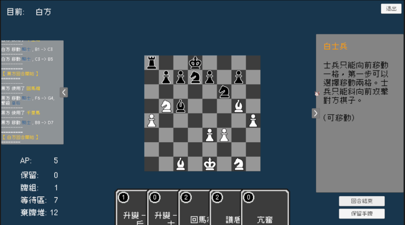
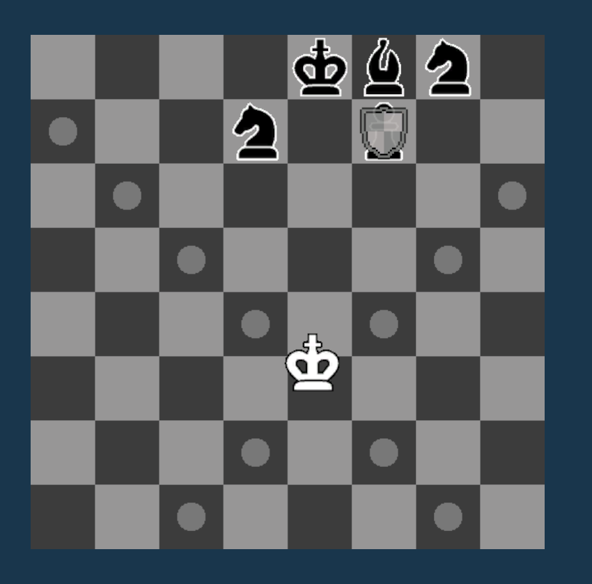
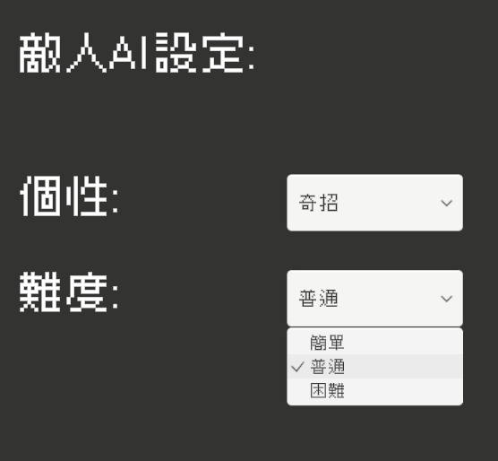

# Warriors & Spells（ChessCard）

結合 **西洋棋** 與 **卡牌構築** 的回合制策略遊戲。我一個人獨立完成遊戲設計、系統架構、AI 演算法、三語在地化，以及 WebGL 佈署。

▶ **線上試玩（itch.io）：<https://shaddock3745.itch.io/warriors-and-spells>**



> 國立臺灣科技大學 應用科技學士學位學程 實務專題（大三下）
> 題目：結合資料驅動架構與束搜尋評估演算法之西洋棋卡牌對戰遊戲開發

## 遊戲規則

- 開局時雙方場上只有一枚**國王**，其他棋子要靠「召喚卡」放上棋盤；被吃掉的子力也能再召喚回來，劣勢方有翻盤空間
- 目標是**擊殺對方國王**，沒有和局
- 每回合抽 5 張手牌、獲得 5 點 **AP（行動點數）**，所有行動共用同一個資源池：
  - 移動 1 枚棋子：1 AP（每回合 1 次），走法依西洋棋規則
  - 發動卡牌：消耗卡牌上標示的 AP
  - 保留 1 張手牌到下回合：1 AP
- 卡牌在 5 個區域之間流動：手牌、牌組、保留區、等待區、棄牌堆
- 開局前可以自由編輯牌組，或使用預設牌組
- 單局平均約 30 回合

### 卡牌

共 **49 張**。召喚卡依子力定價（兵 1、主教 / 騎士 2、城堡 3、皇后 5），功能卡多為 1～3 費，例如：

| 卡牌 | 效果 |
| --- | --- |
| 王車易位 Castling | 國王與一枚我方城堡互換位置 |
| 政教合一 Theocracy | 這回合國王可以用主教的走法移動 |
| 徵兵令 Conscription | 我方士兵少於 3 枚時，手牌加入 2 張 0 費的「士兵」 |
| 護盾 Shield | 讓一枚棋子在一段時間內無法被攻擊 |



## 技術重點

### 卡牌效果管線：用積木組合出 49 張卡

每張卡不是各寫一個類別，而是由**約 40 個可重複使用的效果類別**組合而成，集中註冊在 [`CardEffectManager.cs`](Assets/Scripts/Cards/CardEffectManager.cs)：

```csharp
// 王車易位：選一枚我方城堡 → 讓它本回合不能動 → 與國王交換位置
cardRegistry[7] = new GetTargetPipelineEffect(
    new SelectChessEffect(true, ChessType.Rook),
    new AddStatusToPayloadTargetChessEffect(startTurn => new ChessCantMoveStatus(false, startTurn, startTurn + 1)),
    new SwapChessPositionEffect((state, casterIsWhite, payload) =>
        (payload.getTargetPositions()[0], state.getPositionOfKing(casterIsWhite))));
```

- 組合器：`CompositeEffect`（條件檢查加多個效果並列）、`GetTargetPipelineEffect`（先選目標，把目標包成 Payload 依序傳給後續效果）
- 開發後期，新增一張卡只需要「在註冊表寫一行組裝程式、在 JSON 補三種語言的文字」

### 統一規則驗證（ActionValidator）

開發中期，規則判定分散在 UI 點擊、卡牌效果和 AI 三個地方，判定不一致成為最主要的 bug 來源。後來重構成統一的 [`ActionValidator`](Assets/Scripts/Core/ActionValidator.cs)，集中處理：
- 卡牌能否發動
- 移動是否合法：次數上限、移動費用、狀態限制
- 攻擊是否合法

關鍵的一步，是把合法走法的查詢對象從實際棋盤改成以參數傳入的 `BoardState`。從此「玩家點棋子時顯示可走格」和「AI 在虛擬棋盤上推演」呼叫的是同一個函式，規則只有一份，就不會不一致。

### 狀態系統與走法策略

- **走法用策略模式**：`MovementType` 介面實作西洋棋六種標準走法，再加上卡牌專用的變體。卡牌要暫時改變走法時，只要掛上一個狀態，例如「政教合一」就是替國王掛上 `ChessMovementOverrideStatus(new BishopMovement())`，期限到就自動還原
- **泛型狀態容器**：棋子和玩家身上有時效的狀態（定身、無敵、額外 AP、禁用某張卡…），統一交給 `StatusContainer` 管理：
  - 生命週期：依目前回合數判斷是否生效，過期狀態集中清理
  - 效果疊加：同類型的狀態由容器加總
  - AI 價值：每個狀態自己回報對盤面的分數（例如無敵 +40、定身 −20），評估函數不需要認識任何具體狀態
- 新增一種狀態效果時，遊戲核心流程完全不需要修改

### 虛擬推演與真實執行分離

- `BoardState`、`PlayerData` 都可以深度複製成虛擬盤面，讓 AI 推演
- AI 的三種行動（移動棋子、使用卡牌、保留卡牌）都實作 `AiOption`：
  - 推演時呼叫 `executeVirtually()`，只修改虛擬狀態
  - 決定計畫後才呼叫 `execute()`，由各個 Manager 播放動畫與音效
- 會連鎖觸發的狀態效果都寫成真實 / 虛擬兩個版本，保證 AI 推演的世界和真實遊戲遵守完全相同的規則

### 對戰 AI

這個遊戲一回合可以連續做好幾個行動，所以 AI 要輸出的是**一整條行動序列**，不是單一步棋。[`AiManager.cs`](Assets/Scripts/Ai/AiManager.cs) 的做法：

- **束搜尋（Beam Search）**：每層只保留分數最高的 6 條路徑（束寬 6），深度上限 8 步，最後取前 25 名進入精算
- **對手回應預讀**：對每條候選計畫，窮舉對手下一步所有合法的移動與攻擊，取對我方最傷的結果作為計畫的真實分數
- **勝負短路**：己方國王會被擊殺的局面直接判 −99999 分，所以 AI 不會走出「下完之後對手一步就將死我」的計畫
- **停手基準**：先算出「這回合什麼都不做」的分數，最佳計畫明顯更好才執行；否則就保留高費卡片、結束回合，不為了動而動
- **不偷看牌堆**：推演遇到抽牌等隨機效果時就停在那裡結算，實際執行、手牌確定之後再重新規劃剩下的回合

**評估函數**（[`AiEvaluator.cs`](Assets/Scripts/Ai/AiEvaluator.cs)）由七個部分組成：
- 子力價值
- 位置表（PST）
- Bitboard 威脅損失
- 王區壓力
- 將軍獎懲
- 機動力
- 手牌資源與狀態價值

其中最關鍵的是**威脅損失**：
- 用兩個 64 位元整數當作黑白雙方的攻擊圖，同時記錄每一格的「最低身價攻擊者」和「是否有友軍保護」
- 沒有保護、又受到攻擊的棋子，直接扣除全額價值
- 有保護的棋子，扣除「自身價值 − 最低身價攻擊者價值」，近似靜態交換評估（SEE）
- 這一項解決了早期 AI 把大子召喚到敵方火線上送死的問題

**4 種個性 × 3 種難度**（[`AiProfile.cs`](Assets/Scripts/Ai/AiProfile.cs)）：

| 個性 | 權重特徵 | 預設牌組風格 |
| --- | --- | --- |
| 均衡 Balanced | 各項 1.0 基準 | 攻守資源混合 |
| 激進 Aggressive | 攻擊 1.6、防守 0.6，敢冒險 | 進攻與節奏卡 |
| 保守 Conservative | 防守 1.6、攻擊 0.7，重視保留手牌 | 防護與資源卡 |
| 奇招 Tricky | 機動力高，偏好使用卡片連段 | 卡牌連段與操控 |

難度是在最終評分上加入隨機雜訊：簡單 ±1200、普通 ±500、困難 ±100。只用一個參數，就能模擬不同棋力的失誤率。困難模式在實測中，玩家如果不主動找出卡牌之間的連段，連身為開發者的我也很難穩定獲勝。



**WebGL 調適**：瀏覽器是單執行緒，記憶體也有限制，所以針對 WebGL 做了以下處理：
- AI 在主執行緒上用時間切片運算，每幀用完預算就讓出畫面，避免卡頓
- 搜尋時只保存動作序列，需要盤面時才從根節點重播重建，降低同時存在的盤面複本數量

> 註：這裡的「AI」指的是搜尋與評估演算法，不是會學習的機器學習模型。

### 資料驅動與在地化

- **三種語言**：繁體中文 / English / 日本語。卡牌資料和介面文字全部放在 JSON（[`CardList.json`](Assets/Resources/CardList.json)、[`Localization.json`](Assets/Resources/Localization.json)），程式碼裡沒有寫死的顯示文字
- **中日文字型**：把遊戲用到的字元預先烘焙成靜態 SDF 字型圖集，避免執行時反覆重建字型、讓檔案變大
- **存檔**：牌組、語言、AI 設定存成 JSON。WebGL 版透過自訂的 `.jslib` 呼叫 `FS.syncfs`，把資料寫進瀏覽器的 IndexedDB，關掉分頁也不會遺失
- **流程控制**：回合流程以 `async` / `await` 串接 AI 思考、卡牌與棋子動畫，用 C# 事件廣播回合開始 / 結束

## 技術

- Unity 6（6000.3.7f1），2D URP
- C#
- 套件：Input System、TextMesh Pro、Newtonsoft Json、DOTween
- 發布平台：WebGL（itch.io）

## 開啟專案

1. 用 Unity Hub 加入此資料夾，Editor 版本選 **6000.3.7f1**
2. 開啟 `Assets/Scenes/StartScene.unity`，按 Play

## 未來規劃

- 行動裝置移植（觸控操作、直式畫面）
- 連線對戰：行動都已經是可序列化的 `AiOption`，適合直接當作網路同步的指令
- 對手回應從預讀一步，改成多層 minimax 加 alpha-beta 剪枝
- 替換目前的暫代美術，加入卡面與特效

## 專案結構

```
Assets/
├── Scripts/
│   ├── Core/          # 遊戲流程、對局資料、ActionValidator
│   ├── Board/         # 棋盤、格子、盤面狀態（可深度複製給 AI 推演）
│   ├── Chess/         # 棋子與各種走法策略
│   ├── Cards/         # 卡牌、效果註冊表
│   │   └── Effect/    # 效果積木與組合器
│   ├── Status/        # 棋子 / 玩家狀態容器
│   ├── Ai/            # 束搜尋、評估函數、個性與難度
│   ├── PlayerData/    # 牌組與卡牌區域
│   ├── DataStream/    # JSON 讀寫與 WebGL 存檔
│   ├── Ui/ Menu/ Input/ Log/ ButtonScripts/
├── Resources/         # CardList.json、Localization.json
├── Scenes/            # 開始、牌組設定、說明、對戰
├── Prefabs/
└── Pics/              # 棋子、卡牌、說明圖片
```

## 使用的第三方資源

- 字型：[Cubic 11（俐方體11號）](https://github.com/ACh-K/Cubic-11)，SIL Open Font License 1.1
- 動畫：[DOTween](https://dotween.demigiant.com/)（Demigiant）
